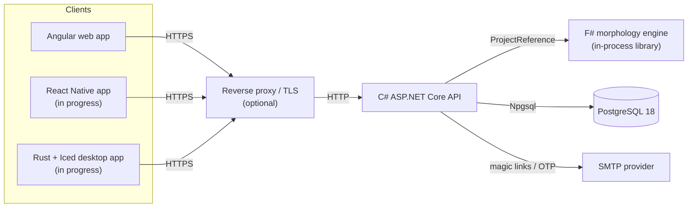
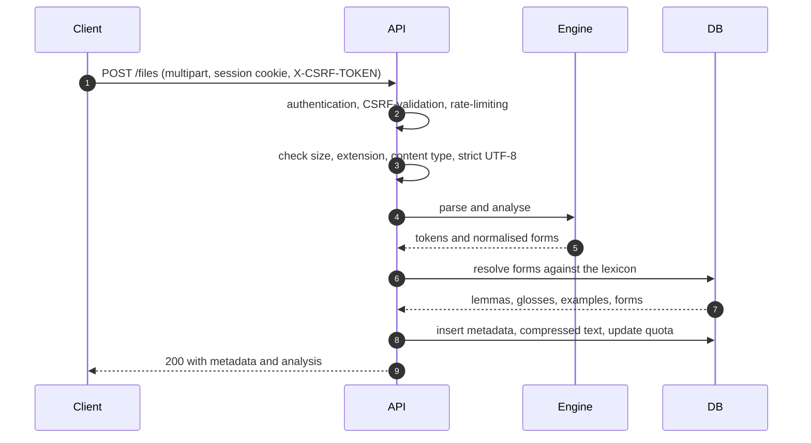

# Greek Reader API

The ASP.NET Core API for **Greek Reader**, a reading assistant for Modern Greek with morphological analysis.

> [!NOTE]
> This project was made possible using [Wiktionary](https://en.wiktionary.org/) data extracted by [Kaikki](https://kaikki.org/). Many thanks to the Wiktionary contributors and to Kaikki for making it available, I sincerely appreciate your work.

---

## Overview and architecture

Greek Reader helps you read Modern Greek texts by showing what each word is doing: its dictionary form (lemma), part of speech, glosses, example usage, and every known inflected form with its grammatical features. You can upload a plain-text passage, read it with analysis attached, and save lemmas you want to revisit.

Modern Greek is the supported language today; Ancient Greek support is planned for a future release.

This repository contains the C# API, the PostgreSQL schema and migrations, and the Docker Compose stack that builds and runs the whole application. The morphology engine is a separate F# project referenced directly from this solution, so lexicon parsing and text normalisation run in-process rather than over a network boundary.



The API owns authentication, uploads, quota enforcement, rate limiting, and persistence. The F# engine owns canonicalisation, tokenisation, and the parsed Wiktionary lexicon. PostgreSQL stores accounts, login tokens, the lexicon, saved lemmas, and uploaded file content.

---

## Features

- **Passwordless accounts** — email magic links or a 6-digit one-time code.
- **Text uploads** — plain-text files up to 1 MiB, stored compressed and scoped to the owner.
- **Morphological analysis** — token-level lemmas, glosses, examples, and inflected forms.
- **Lexicon browsing** — page through every lemma and filter by part of speech, lemma text, inflected form (exact or partial), example text, or grammatical features. Form filters ignore accents, case, and final sigma.
- **Saved lemmas** — save words with context and filter them by part of speech, form, feature, or date.
- **Feature listing** — discover the grammatical features available for a part of speech, for frontend filters.
- **Abuse controls** — IP rate limits, per-email throttling, upload validation, and per-user storage quotas.
- **Account deletion** — removes the account and cascades to its tokens, files, and saved lemmas.
- **Health and OpenAPI** — `/health` for orchestration and Swagger/OpenAPI enabled by default, with a config flag to disable them.

---

## Tech stack

| Component | Choice | Why |
|---|---|---|
| HTTP API | ASP.NET Core on .NET 10 (Minimal APIs) | First-class cookie auth, antiforgery, rate limiting, validation, and OpenAPI without extra plumbing. |
| Morphology engine | F# on .NET 10 | Pattern matching and a strongly typed domain model suit the irregularity of Greek morphology; referenced as a project so calls stay in-process. |
| Database | PostgreSQL 18 | Reliable relational storage with array columns for features and glosses, `citext` emails, and TOAST for compressed text. |
| Desktop client (in progress) | Rust + Iced | Native cross-platform desktop client for the same API, without a web runtime. |
| Deployment | Docker Compose + a reverse proxy | One reproducible stack across three repositories; the proxy handles TLS while the containers publish only on loopback. |

---

## Getting started

The stack builds three repositories together. Clone them into the layout that `.env.example` and `compose.yaml` expect by default:

```
greek-reader/
├── backend/
│   ├── api/        # this repository (compose.yaml lives here)
│   └── engine/     # F# morphology engine
└── frontend/
    └── web/        # Angular web client
```

### Prerequisites

- Docker Engine with Compose v2 (BuildKit enabled)
- `git` and `openssl`
- A few GB of free disk for images, build layers, and the database volume
- Optional: .NET 10 SDK if you want to run the API outside Docker

### Clone and configure

```bash
mkdir -p greek-reader && cd greek-reader
mkdir -p backend frontend

git clone https://github.com/toasted226/greek-reader-api.git backend/api
git clone https://github.com/toasted226/greek-reader.git backend/engine
git clone https://github.com/toasted226/greek-reader-fe.git frontend/web

cd backend/api
cp .env.example .env

# Generate a password, then paste it into POSTGRES_PASSWORD in .env.
openssl rand -hex 32
```

For local development you can leave the SMTP placeholders in `.env`: the local override runs the API in `Development`, which uses the console email sender instead of a real mail server. The sign-in email and OTP will be printed to the API logs.

The default `ENGINE_CONTEXT` and `FRONTEND_CONTEXT` values already match the layout above. If your checkouts live elsewhere, update those two paths in `.env`.

### Run the stack

```bash
docker compose -f compose.yaml -f compose.local.yaml up -d --build
```

This builds the API image (including the F# engine), builds the frontend image, starts PostgreSQL, and runs the one-shot `migrate` service before the API starts.

On a fresh database the lexicon is empty. Import it once so analysis has something to resolve against:

```bash
docker compose -f compose.yaml -f compose.local.yaml --profile import run --rm import
```

> `--import` is destructive: it truncates `lemmas`, `forms`, `examples`, and `user_lemmas`. Run it on a new database only; future lexicon updates should use a migration.

### Confirm it works

```bash
curl -fsS http://localhost:5080/health
curl -fsS http://localhost:5080/
curl -s -X POST http://localhost:5080/lexicon/analyse \
  -H 'Content-Type: application/json' \
  -d '{"text":"λόγος"}'
```

Expected results:

- `/health` returns `Healthy`.
- `/` returns `{"message":"API online."}`.
- `/lexicon/analyse` returns tokens and lemma data (after the import).
- The web app is at [http://localhost:4000](http://localhost:4000); it redirects to the dashboard after load.
- Swagger is at [http://localhost:5080/swagger](http://localhost:5080/swagger).

Check container status with `docker compose ps`. If a service is unhealthy, inspect it with `docker compose logs api` (or `db`, `frontend`).

### Run the API without Docker (optional)

You will need .NET 10, a local PostgreSQL instance, and the F# engine checked out at the path in `GreekReaderAPI/GreekReaderAPI.csproj`. Update the `ConnectionStrings:Postgres` value in `GreekReaderAPI/appsettings.Development.json`, then:

```bash
dotnet build GreekReaderAPI/GreekReaderAPI.csproj
dotnet GreekReaderAPI/bin/Debug/net10.0/GreekReaderAPI.dll --migrate
dotnet GreekReaderAPI/bin/Debug/net10.0/GreekReaderAPI.dll --import
dotnet run --project GreekReaderAPI/GreekReaderAPI.csproj
```

---

## Configuration

`.env` is the single source of configuration for the Compose stack. Secrets live there too; keep the file `chmod 600` and never commit it. Application settings use ASP.NET Core's environment-variable convention: `FileUpload__MaxFileBytes` sets `FileUpload:MaxFileBytes`.

Copy [`.env.example`](.env.example) to `.env` and fill it in. At minimum set `POSTGRES_PASSWORD`, `API_BASE_URL`, `FRONTEND_BASE_URL`, and the SMTP settings. Every variable, its default, and how it maps onto container settings are documented in the [configuration reference](docs/CONFIGURATION.md#environment-variable-reference).

In production the API validates required configuration at startup and exits with a message naming the missing setting. It never logs the values.

---

## API overview

All routes are relative to the API origin. [Swagger UI](http://localhost:5080/swagger) is enabled by default, backed by the OpenAPI document at `/openapi/v1.json`. Set `OpenApi__Enabled=false` (or `OPENAPI_ENABLED=false` in Compose) to disable both.

---

## Authentication and security

- **Session cookies.** Sign-in is passwordless: a magic link valid for 15 minutes, or a 6-digit OTP valid for 5 minutes with at most 5 attempts. Both set an HttpOnly `session` cookie with `SameSite=Lax`, a 1-day sliding expiry, and `Secure` outside development.
- **CSRF.** After login the client calls `GET /auth/csrf`; uploads must send the returned token in the `X-CSRF-TOKEN` header.
- **Enumeration resistance.** `/auth/request` and `/auth/otp/request` return the same `204` for every valid request, regardless of whether the email exists, the send was throttled, or mail was actually sent.
- **Upload security.** Every file route checks ownership, and per-user limits cap storage at 100 files and 50 MiB of normalised text. Size, type, and encoding validation are covered in [Upload and analysis flow](#upload-and-analysis-flow).
- **Error handling.** Unhandled exceptions are logged server-side with a trace ID, while clients receive a generic `application/problem+json` body containing only the trace ID and an error code.

### Rate limiting and throttling

  | Scope | Limit |
  |---|---|
  | `POST /auth/request` per IP | 5 requests / 10 minutes |
  | `POST /auth/otp/request` per IP | 5 requests / 10 minutes |
  | `POST /files` per IP | 10 requests / minute |
  | Magic-link and OTP sends per email | 1 per 60 seconds, 5 per 15 minutes |

The per-email counter is shared between the magic-link and OTP endpoints, so alternating between them cannot bypass it. Throttle and rate-limit state is in-process, designed for a single-instance deployment.

Full implementation notes are in [docs/SECURITY.md](docs/SECURITY.md).

---

## Upload and analysis flow

The upload endpoint is deliberately synchronous: the same request validates the file, normalises it, analyses it, persists it, and returns the first analysis. That keeps the client simple at the cost of a longer upload request.



Text is compressed with gzip before storage, metadata is kept in a separate table so listing files stays cheap, and files are re-analysed on read so results stay current after lexicon updates.

---

## Deploying with Docker

`compose.yaml` defines the full stack and can be used as-is for a self-hosted deployment:

| Service | Role |
|---|---|
| `db` | PostgreSQL 18, internal network only, named volume `postgres-data`. |
| `migrate` | One-shot DbUp migration runner; must complete before the API starts. |
| `api` | The ASP.NET Core API, published on the API host port. |
| `import` | Optional one-shot lexicon import, enabled with `--profile import`. |
| `frontend` | The Angular app, published on the web host port. |

### 1. Point Compose at the source repositories

The API image builds the F# engine from source, and the same Compose invocation builds the Angular frontend. The defaults in `compose.yaml` and `.env.example` match the self-hosted layout from [Getting started](#getting-started):

```env
ENGINE_CONTEXT=../engine
FRONTEND_CONTEXT=../../frontend/web
```

Both paths are relative to the directory containing `compose.yaml`. Adjust them in `.env` if your checkouts live elsewhere.

### 2. Configure the deployment

```bash
cp .env.example .env
```

At minimum, set:

- `POSTGRES_PASSWORD` — generate one with `openssl rand -hex 32`.
- `API_BASE_URL` and `FRONTEND_BASE_URL` — the public origins users and the frontend will call.
- `SMTP_HOST`, `SMTP_PORT`, `SMTP_FROM`, and any required SMTP credentials.
- `ASPNETCORE_ENVIRONMENT=Production` — enables secure cookies and startup configuration validation.
- `OPENAPI_ENABLED` — defaults to `true`; set it to `false` to disable Swagger UI and the OpenAPI document.
- `API_BIND`/`API_PORT` and `WEB_BIND`/`WEB_PORT` — host bindings. Keep both on `127.0.0.1` when a reverse proxy sits in front.

Also set `AllowedHosts` in `appsettings.Production.json` to the API hostname(s) you will serve. Do not use `*`.

### 3. Build and start

```bash
docker compose up -d --build
```

This builds the API image (including the F# engine), builds the frontend image, starts PostgreSQL, runs the migrations, and starts the API.

On a fresh database the lexicon is empty. Import it once:

```bash
docker compose --profile import run --rm import
```

`--import` truncates `lemmas`, `forms`, `examples`, and `user_lemmas`, so run it on a new database only.

### 4. Verify

```bash
curl -fsS http://localhost:5080/health
curl -fsS http://localhost:5080/
docker compose ps
```

### Reverse proxy and TLS

The containers publish on loopback by default. Put a reverse proxy or load balancer in front to terminate TLS. Whatever you use (nginx, Caddy, Traefik, or a cloud load balancer), it must:

- preserve the `Host` header;
- send `X-Forwarded-For` and `X-Forwarded-Proto`;
- allow request bodies of at least 2 MiB (the 1 MiB upload limit plus multipart overhead);
- allow read timeouts of at least 180 seconds, because sign-in sends email synchronously.

The API trusts forwarded headers so rate limiting and audit logging see the real client IP. This is only safe when the API port is not directly reachable from the internet.

### Persistent volumes

Two named volumes must survive redeploys:

- `postgres-data` — accounts, lexicon, saved lemmas, and uploaded files.
- `dataprotection-keys` — the key ring used to protect session cookies.

Losing the key ring invalidates every session. Losing the database volume loses all user data. See [`docs/DATA_PROTECTION.md`](docs/DATA_PROTECTION.md) for backup and rotation guidance.

### Single-instance assumption

The stack runs one API instance. IP rate limits, per-email throttles, and Data Protection keys are in-process, so a restart clears the throttles. Scaling to multiple API replicas requires a shared limiter (for example Redis) and a shared key ring.

### How the F# engine is built

The API's `Dockerfile` receives the engine as a BuildKit named context:

```yaml
build:
  context: .
  additional_contexts:
    engine: ${ENGINE_CONTEXT:-../engine}
```

The Dockerfile copies the F# source into `/src/fsharp/GreekReader`, preserving the synthetic path that the existing `ProjectReference` expects. Nothing is published to NuGet, so any machine with Docker and the three checkouts can build the stack.

---

## Known limitations and roadmap

Current scope is intentionally narrow:

- **Plain text only.** `.txt`/`.text`, UTF-8, 1 MiB per file. No PDF, EPUB, DOCX, or HTML ingestion.
- **Synchronous work.** Uploads analyse inline and sign-in sends mail inline; there is no job queue or retry worker.
- **Limited paging and no caching.** File and saved-lemma lists return everything; the lexicon query is paged, but deep offsets are not optimised. Opening a file re-runs analysis rather than serving a cached result.
- **Single instance.** In-memory rate limits, throttles, and Data Protection keys assume one API replica.
- **Destructive lexicon import.** `--import` is first-deploy only; later lexicon changes need a migration.
- **No API keys yet.** Non-browser clients must use the cookie-based sign-in flow.
- **No automated test suite or CI in this repository yet.** The API is verified manually with HTTP and runtime checks; the F# engine has its own conversion tests.

Planned and under consideration:

- Ancient Greek support alongside Modern Greek
- PDF (and other document) upload support
- API keys for non-browser clients
- Google sign-in alongside email magic links and OTP
- Anki export / integration for saved lemmas
- Pagination and response caching for large libraries
- A background analysis queue
- Automated API integration tests and CI across the API, engine, and frontend

---

## Related repositories

| Repository | Description |
|---|---|
| [toasted226/greek-reader-api](https://github.com/toasted226/greek-reader-api) | This repository: C# API, database, Compose stack. |
| [toasted226/greek-reader](https://github.com/toasted226/greek-reader) | F# morphology engine and Wiktionary lexicon parsing. |
| [toasted226/greek-reader-fe](https://github.com/toasted226/greek-reader-fe) | Angular web client. |

The React Native mobile client and the Rust + Iced native desktop client are in progress and are not yet published.

## License

This project is licensed under the [MIT License](LICENSE).

Dictionary data is derived from [Wiktionary](https://en.wiktionary.org/) contributors' work, extracted by [Kaikki.org](https://kaikki.org/) using [wiktextract](https://github.com/tatuylonen/wiktextract). It is available under the [Creative Commons Attribution-ShareAlike 4.0 International License (CC BY-SA 4.0)](https://creativecommons.org/licenses/by-sa/4.0/). The data has been modified for this project (filtered, normalised and restructured). The MIT licence in this repository covers the source code only, not the Wiktionary-derived data.

## Contributing

Issues and pull requests are welcome. There is no formal contribution guide or automated test suite yet, so please keep changes focused, describe the behaviour you changed, and include manual verification steps (the API, the F# engine, and the frontend are separate repositories, so note which ones a change touches).
